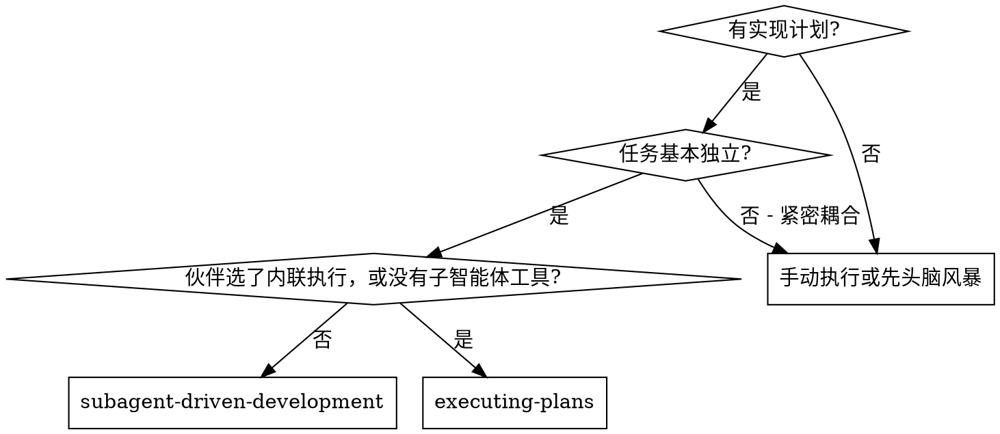
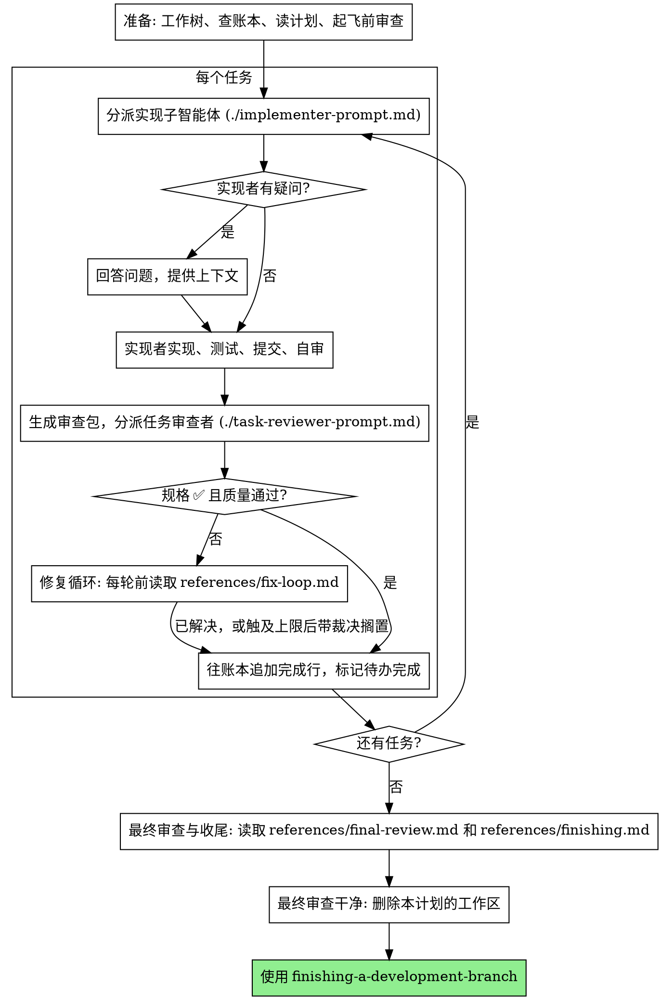

# 子智能体驱动开发

通过为每个任务分派一个全新的实现子智能体来执行计划：每个任务完成后做一次任务审查（规格合规性 + 代码质量），全部任务结束后再做一次覆盖整个分支的宽范围审查。

**为什么用子智能体：** 你把任务委派给具有隔离上下文的专用智能体。通过精心设计它们的指令和上下文，确保它们专注并成功完成任务。它们绝不应继承你会话的上下文或历史记录——你要精确构造它们所需的一切。这样也能为你自己保留用于协调工作的上下文。

**核心原则：** 每个任务一个全新子智能体 + 任务审查（规格 + 质量）+ 结尾宽范围审查 = 高质量、快速迭代

**旁白：** 工具调用之间最多说一句简短的旁白——进度账本和工具结果本身就是记录。

**持续执行：** 不要在任务之间停下来向你的人类伙伴确认。不间断地执行计划里的所有任务。唯一该停下的理由是下文列出的四类情形，或所有任务已完成。"我该继续吗？"之类的询问和进度小结都在浪费他们的时间——他们让你执行计划，那就执行。

**做裁决，不要停摆。** 一个正在跑的计划不等人。冲突、歧义、计划缺陷、你本来想申请突破的上限——你自己定。规格是有约束力的权威，计划是它的论证，两者都答不上来的部分由你的判断来定。每个决定都以 `Ruling: <你决定了什么> — <为什么> — <如果错了代价是什么>` 记进账本，然后继续。一个错误的裁决，代价是你人类伙伴看得见、也撤得掉的返工；一个停在问题上的会话，代价是他们的一整天，而且什么也换不来。

只有四件事会让你停下，也只有这四件：不可逆或破坏性的操作；涉及安全的动作；这个工作树之外、按惯例应当先问一声的副作用（合并、推送到共享分支、发布）；以及一个坏到每条前进路径都只能靠猜的计划。遇到这四类，停下来问。

## 何时使用

**与 Executing Plans（内联执行）的对比：**
- 每个任务一个全新子智能体（无上下文污染），而不是一个上下文包揽所有任务
- 每个任务后做审查（规格合规性 + 代码质量），而不是只在结尾审查
- 代价是每个任务、每次审查各一个全新上下文；内联执行的代价是一个上下文加一个最终审查者
- 两者都在当前会话里运行，共用同一个计划工作区和账本，任务之间都不停顿

## 流程

## 准备

**执行此步骤前，必须从磁盘读取** [完整指导](references/preflight-and-resuming.md)，按其中的规则执行；上下文压缩后再次读取。

## 模型选择

在能胜任的前提下，为每个角色选用最弱的模型，以节省成本、提升速度。

**机械性实现任务**（孤立的函数、清晰的规格、1-2 个文件）：用快而便宜的模型。计划写得好时，大多数实现任务都是机械性的。

**集成与判断类任务**（跨文件协调、模式匹配、调试）：用标准模型。

**架构与设计类任务**：用可用的最强模型。覆盖整个分支的最终审查就属于这一类——用可用的最强模型去分派它，不要用会话默认模型。

**审查任务**：用同样的判断来选模型，并按 diff 的体量、复杂度和风险来缩放。一个小的机械性 diff 不需要最强模型；一个微妙的并发改动需要。小修复 diff 的定向复审用便宜到中档的层级即可。

**修复循环的升级（第 4-5 轮）**：用比那个卡住了的实现者**至少高一档**的模型。

**分派子智能体时永远显式指定模型。** 省略模型会继承你会话的模型——往往是最强也最贵的那个——这会悄无声息地让本节的努力全部失效。

**轮次数比 token 单价更要紧。** 墙钟时间和上下文成本是随子智能体花掉多少轮次而增长的，而最便宜的模型在多步工作上经常要花 2-3 倍轮次——总账反而更贵。审查者、以及依据散文式描述工作的实现者，都以中档模型为下限。当任务的计划原文里已经包含了要写的完整代码时，实现就是抄写加测试：这种实现者用最便宜的层级。单文件的机械性修复也用最便宜的层级。

**任务复杂度信号（实现类任务）：**
- 涉及 1-2 个文件且规格完整 → 便宜模型
- 涉及多个文件且有集成考量 → 标准模型
- 需要设计判断或对代码库的广泛理解 → 最强模型

## 任务循环

**把同形状的小活打包。** 当计划里列了好几个任务，每个都是同一类的小改动——同样的一行修复、同样的常量替换、同样的字段新增，只是散在不同文件里——不要一个任务派一个子智能体。写**一份**分派简报，把每个文件和它的改动都列上，整批交给同一个子智能体，把它的 diff 当作一个单位来审查。一个任务一次分派，留给那些需要自己的判断、自己的测试、自己的审查面的活。

你粘进分派提示词里的一切、以及子智能体打印回来的一切，都会在本次会话余下的时间里常驻你的上下文，并且在之后每一轮被重新读一遍。**产物要用文件来交接。**

**等待已分派的子智能体：** 绝不用短超时去轮询等待接口，也绝不干坐在一次沉默的、没有上限的等待里。只要你手上还有本地活可干——更新账本、打包下一次审查、读报告——就接着干；子智能体的结果会自己送到。当你真的空了，就分段等待，每段有上限（在你的平台允许的范围内，五到十分钟），两段之间发一行状态，并对账你还活着的子智能体：把它们列出来，追一下那些干完了却没报告的。分段等待几乎保留了长等待的全部效率，同时保证一个卡住或丢失的子智能体在几分钟内就被发现，而不是拖到会话最后。

### 1. 分派实现者

分派之前记录 BASE（`git rev-parse HEAD`）——审查包和各轮修复的 diff 都要用它。

- **任务简报：** 分派实现者之前，运行本技能的 `bash scripts/task-brief PLAN_FILE N`（从正在执行的项目工作树中，用脚本的绝对路径运行）——它把该任务的完整文本抽取到一个唯一命名的文件并打印路径。组织你的分派，让这份简报保持为需求的唯一来源。你的分派应包含：(1) 一行说明这个任务在项目中的位置；(2) 简报路径，引入语为"先读这个——它是你的需求，里面有要逐字使用的精确取值"；(3) 简报无从知晓的、来自前序任务的接口和决策；(4) 你对简报中注意到的任何歧义的裁定；(5) 报告文件路径和报告契约。精确取值（数字、魔法字符串、签名、测试用例）只出现在简报里。**绝不**让子智能体去读整个计划文件。
- **报告文件：** 实现者的报告文件按简报来命名（简报 `…/task-N-brief.md` → 报告 `…/task-N-report.md`），并写进分派提示词。实现者把完整报告写在那里，只回传状态、提交、一行测试小结和疑虑。
- 一个分派提示词描述的是**一个任务**，不是会话的历史。不要把累积的前序任务小结（"任务 1-3 之后的状态"）粘进后面的分派——真实会话里曾出现过 42k 字符的分派，其中 99% 是粘贴的历史。一个全新的子智能体需要的是：它的任务、它要碰的接口、以及全局约束。别无其他。
- 如果前面某个任务把一条发现搁置在本任务要碰的区域，就在分派里带上指向那条账本记录的指针。
- 分派本身携带**不派子智能体**的契约（它就写在实现者模板里）：实现者绝不分派子智能体——不派帮手，更不派审查者。审查由你在报告之后送达。在真实会话里，工作者自己派出的每一个审查者，都在重复控制者本来就会分派的那次任务审查——每个任务白白多出一个完整的审查席位。
- **记下分派结果里实现者的智能体身份**——第 1-3 轮修复要唤回这个智能体。
- 绝不并行分派多个实现子智能体（会冲突）。

模板：[implementer-prompt.md](implementer-prompt.md)

### 2. 处理报告

**执行此步骤前，必须从磁盘读取** [完整指导](references/report-handling.md)，按其中的规则执行；上下文压缩后再次读取。

### 3. 审查任务

逐任务审查是**任务范围内的关卡**。宽范围审查只做一次，在最终的整分支审查那里。绝不跳过任务审查，也绝不接受一份缺少任一结论的报告——规格合规性**和**任务质量两者都必须有。实现者的自审永远不能替代任务审查；两者都需要。

- **把 diff 作为文件交给审查者：** 运行本技能的 `bash scripts/review-package PLAN_FILE BASE HEAD`（从正在执行的项目工作树中，用脚本的绝对路径运行），把它打印出的文件路径交给审查者（若没有 bash：对该区间跑 `git log --oneline`、`git diff --stat`、`git diff -U10`，重定向到一个唯一命名的文件）。这些输出永远不会进入你自己的上下文，而审查者在一次 Read 调用里就能看到提交列表、stat 摘要和带上下文的完整 diff。用你在分派实现者之前记录下的 BASE——**绝不用** `HEAD~1`，那会悄悄截断多提交任务。**绝不**在没有 diff 文件的情况下分派任务审查者。
- **审查者的输入：** 任务审查者拿到三个路径——同一份简报文件、报告文件、审查包——外加约束该任务的全局约束。
- 你交给审查者的全局约束块是它的**注意力透镜**。从计划的"全局约束"一节或规格里**逐字**抄下有约束力的需求：精确的取值、精确的格式，以及组件之间被明确规定的关系（"与 X 相同的布局"、"匹配 Y"）。审查者的模板里已经带了流程规则（YAGNI、测试卫生、审查方法）——约束块是用来装**这个项目**的规格所要求的东西的。
- 不要在没有具体的、任务专属的理由时，加上"检查所有用法"或"有用的话跑一下竞态测试"这类开放式指令
- 不要让审查者重跑实现者已经在同一份代码上跑过的测试——实现者的报告承载着测试证据
- **不要替审查者预先给发现定性**——绝不指示审查者忽略或不要标记某个具体问题。如果你认为某条发现会是误报，让审查者提出来，然后在审查循环里裁定它。如果你正在写的提示词里出现了"不要标记"、"不要把 X 当缺陷"、"顶多按 Minor 处理"、"计划选择了"——停下：你正在预先定性，而且通常是为了让自己少走一轮审查循环。

任务审查者可能报告"⚠️ 无法从 diff 核实"的条目——那些活在未改动代码里、或者跨任务的需求。这些不阻塞审查的其余部分，但在标记任务完成之前**你必须自己逐条解决它们**：你掌握着审查者所缺的计划和跨任务上下文。如果你确认某一条是真实的缺口，就把它当作规格审查失败来处理——它和其他发现一起进入修复循环。

模板：[task-reviewer-prompt.md](task-reviewer-prompt.md)

### 4. 修复循环

当审查报告规格 ❌、任何 Critical 或 Important 发现，或你确认为真实缺口的 ⚠️ 条目时，循环触发。

**触发时以及每一轮之前，都必须从磁盘读取** [完整指导](references/fix-loop.md) 并按其中的规则执行，即使本会话前面已经读过。它包含轮次上限、熔断和每轮账本记录；上下文压缩后不能依赖记忆。

### 5. 完成任务

当审查干净地返回——或者在触及上限时每条未解决的发现都已带着裁定被搁置——在你做其他记账的同一条消息里，往账本追加完成行：

- `Task <N>: complete (commits <base7>..<head7>, review clean)`
- 熔断触发过的话：`Task <N>: complete (commits <base7>..<head7>, <K> parked)`

然后标记待办完成，继续下一个。**绝不**在审查还有未解决的 Critical/Important 问题、而它们既没被修复也没在上限处带裁定搁置时，就进入下一个任务。

## 最终审查

**执行此步骤前，必须从磁盘读取** [完整指导](references/final-review.md)，按其中的规则执行；上下文压缩后再次读取。

## 收尾

**执行收尾前必须读取** [完整收尾指导](references/finishing.md)，先向人类搭档报告全部裁决再删除本计划工作区。

## 常见的合理化借口

| 借口 | 现实 |
|------|------|
| "规格合规性上差不多就行了" | 审查者发现了规格差距 = 未完成。修掉，或者走到上限去裁定——只有这两个出口。 |
| "我自己修就好了，分派是额外开销" | 控制者的修复会污染你的上下文并跳过审查。唤回实现者。 |
| "再来一轮就收敛了" | 过了上限，轮次不会收敛——那个失败是结构性的。裁定并分流。 |
| "反正审查者总会再挑出新东西" | 定向复审只核实修复，它不能到处乱逛。未改动代码上的新发现进账本，不进循环。 |
| "这条发现明显错了，我直接丢掉" | 你只在上限处裁定，而且每条裁定都是账本记录。静默丢弃是禁止的。 |
| "修复很小，跳过复审吧" | 未经审查的修复正是回归产生的方式。每一轮都以一次定向复审结束。 |
| "审查把循环拖慢了" | 没有审查的循环只是未经核实的空转。审查是这个循环的刹车和方向盘。 |
| "记账本是额外开销" | 账本是能在压缩中存活下来的东西。没有账本的控制者曾重新分派整段已完成的任务序列。 |
| "实现者自己派了个审查者——白送的额外保障" | 那是一个重复的席位，按全价审查同一份 diff，而且它的裁定不算数。审查由控制者分派。 |

## 示例工作流

**执行此步骤前，必须从磁盘读取** [完整指导](references/example-workflow.md)，按其中的规则执行；上下文压缩后再次读取。
