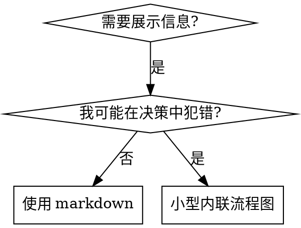

## 流程图使用



**仅在以下情况使用流程图：**
- 非显而易见的决策点
- 你可能过早停止的流程循环
- "何时使用 A vs B"的决策

**绝不使用流程图用于：**
- 参考资料 → 表格、列表
- 代码示例 → Markdown 代码块
- 线性指令 → 编号列表
- 无语义意义的标签（step1、helper2）

参见 @../graphviz-conventions.dot 了解 graphviz 样式规则。

**为你的搭档可视化：** 使用技能目录中的 `render-graphs.js` 将技能的流程图渲染为 SVG：
在 `writing-skills` 技能目录中运行：
```bash
node ./render-graphs.js ../some-skill           # 每个图表分别渲染
node ./render-graphs.js ../some-skill --combine # 所有图表合并为一个 SVG
```

